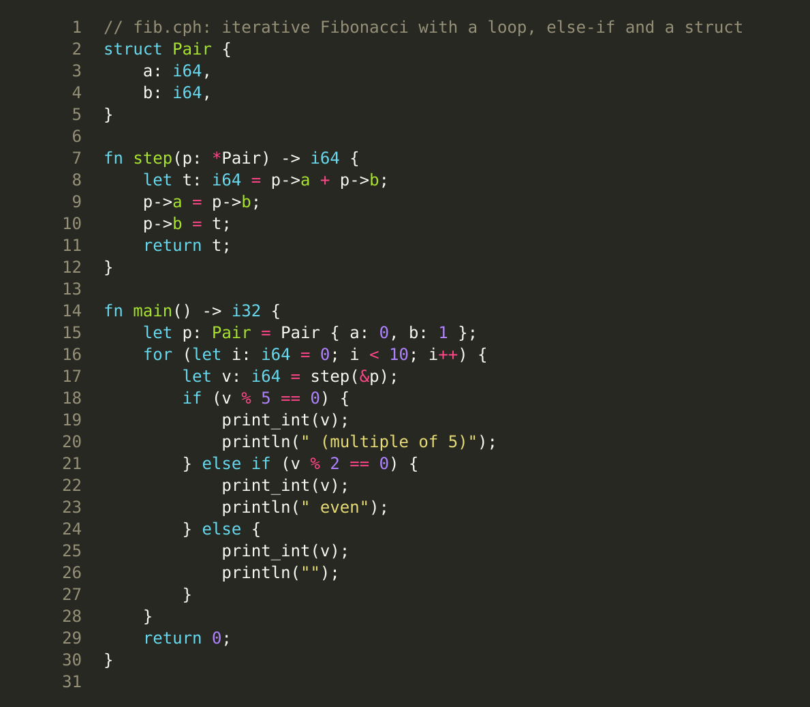
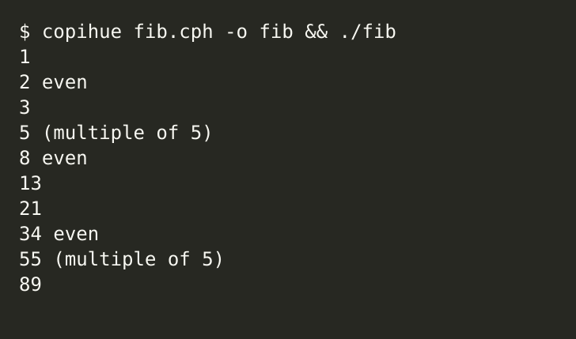

<p align="center"></p>

<h1 align="center">Copihue</h1>

<p align="center">
<a href="https://github.com/ipenas-cl/copihue/actions/workflows/ci.yml"></a>
<a href="https://github.com/ipenas-cl/copihue/releases/latest"></a>
<a href="LICENSE"></a>
</p>

*Formerly Chronos.*

<p align="center"> </p>

**A small systems programming language with its own compiler, written from scratch in C and x86-64 assembly.**
Copihue compiles a C-family language to native Linux x86-64 ELF executables with **no libc and no runtime**.
It can also emit **freestanding** code, with no OS, for kernels and bare-metal programs.
[AtomicOS](https://github.com/ipenas-cl/AtomicOS) is built with `--flat`, with no assembly in the kernel. A boot sector can be built with `--boot`.

> **Status: not production-ready yet.** The goal is to become a real alternative for systems programming.
> Today Copihue is a working, tested compiler for a small language. Memory safety and determinism are
> design goals, not implemented guarantees (see [Roadmap](#roadmap)).

## Install

Requirements: Linux x86-64, `gcc` (or any C99 compiler), `make`, `nasm`, and `ld` (binutils).

```bash
sudo apt-get install -y gcc make nasm binutils
git clone https://github.com/ipenas-cl/copihue.git && cd copihue
make                      # builds ./copihue
make test                 # optional: run the regression suite
make install              # installs copihue to ~/.local/bin (PREFIX=/usr/local to change)
```

## Hello world

```bash
cat > hello.lap <<'LAP'
fn main() -> i32 {
    println("Hello, Copihue!");
    print_int(6 * 7);
    println("");
    return 0;
}
LAP
copihue hello.lap -o hello && ./hello
# Hello, Copihue!
# 42
```

```
copihue [-O0|-O1|-O2] [-o out] [-S] [-c] [--freestanding | --flat ADDR | --boot] [-v] file.lap [more.lap ...]
```

`-S` stops after writing NASM assembly. `-c` writes one ELF64 relocatable object and does not link. `--freestanding` emits assembly for use without an OS (see below). `--boot` writes a 512-byte sector.
The value returned by `main` becomes the process exit code.
Old `.ch` files are still accepted, with a deprecation warning.

## What works today

The full language reference is in [docs/REFERENCE.md](docs/REFERENCE.md).

- Functions, recursion, up to 16 parameters, return types `*T`, `**T`, and `[T; N]` (hosted, freestanding, and flat), structs passed by value (copied) or by pointer
- Block scope: a `let` lives until the end of its block, a nested block may shadow it, and the same name twice in one block is a compile error
- `let` locals, globals, `let volatile` globals, `*volatile T` pointers, `volatile` struct fields, integer types `i8 i16 i32 i64 u8 u16 u32 u64`, typed arrays, slices `[]T` (pointer plus length, checked index in hosted code), pointers, `&`, `*`, `->`
- `struct`s, including nested structs, arrays of structs, array fields `[T; N]`, nested struct literals, and assignment `a = b` (exact size, packed records included). Ordinary fields use their real width and natural alignment. `sizeof` and `offsetof` are compile-time integers
- `packed struct` for hardware records (an x86-64 IDT gate is 16 bytes, a TSS keeps `rsp0` at offset 4, and a `[u8; 16]` field is 16 bytes, not 1)
- Function addresses (`&timer`) and indirect calls, so a table of handlers can be installed from the language
- `interrupt fn` (full GPR save, optional CPU error code, or a pointer to the CPU frame, `iretq` back to the ring in that frame, including ring 3). `save_context(&ctx)` / `restore_context(&ctx)` and `label_addr(name)` switch tasks without naming `rsp` or `rbp`. `syscall fn` (`syscall`/`sysretq` entry, up to 7 arguments)
- `ltr(selector)`, `iretq()`, and `sysretq()` (`o64 sysret` in NASM). A packed 104-byte TSS: `rsp0` at offset 4, IST at 36, and `tss.rsp0 = sp` on a context switch
- `naked fn` and `bits 16` / `bits 32` / `bits 64` on a function, so real mode and protected mode have no 64-bit frame. Inside `naked`, named registers (`ax`, `sp`, `ds`, `rbp`, and the rest of that list, plus `bx`/`bp` and `ebx`/`ebp`/`esi`/`edi` in `bits 16` and `bits 32`) are lvalues and rvalues, and parameters arrive in registers with no frame. A call in `bits 16` or `bits 32` uses those parameter registers (`ax`/`cx`/`dx`/`si` or `eax`/`ecx`/`edx`/`esi`)
- `section "name" { ... }` and `section "name" @ 0x7C00 { ... }` with `--freestanding`, `--flat`, or `--boot`. `@` is the load address of the labels (`vstart`), not a hole in the file. `section_start("name")` and `section_end("name")` are that address and one past the last byte, as `i64`. `bss_start()` and `bss_end()` stay `*u8` and `--flat` only
- `-c` writes one ELF64 relocatable object (`nasm -f elf64`, no `ld`). Functions, `let` globals, and `data` names in that object are `global`. `extern name;` and `extern fn` (including `extern bits 32 naked fn`) name a symbol defined in another object. The object that defines `fn main` emits `_start` and the hosted helpers. `--flat` and `--boot` stay raw binaries and cannot be combined with `-c`. `section @` is rejected with `-c`, because `vstart` is a bin load address and `nasm -f elf64` would ignore it. `import` is still one object, not one object per file
- `data name { db/dw/dd/dq ... }` for a GDT, a disk packet, or a string. `asm()` still splits on `;`, so raw bytes go here
- `ljmp(selector, label)` and `int(n)` for a far jump and a BIOS interrupt. `jmp 0x8200` and `jmp label` are direct jumps. Inside `naked`, `jmp rax` and `jmp [resume_rip]` are indirect (`jmp qword [name]` in 64-bit code, `dword` in `bits 32`, `word` in `bits 16`). `far_jump(selector)` and `retfq()` reload `CS` in 64-bit code, where `jmp sel:label` does not exist. `lodsb`, `stosb`/`stosd`, `rep movs`/`rep stos`, `pushfd`/`popfd`, `push`/`pop`, `stc`/`clc`, `cld`/`std`, and `ud2` are builtins. `extern name` reads a qword defined in `data` or by the compiler (`__syscall_rsp`). `syscall()` in freestanding code is the instruction. `syscall(n, a1, ...)` loads `rax` and up to six arguments (`rdi`, `rsi`, `rdx`, `r10`, `r8`, `r9`). A bare `syscall()` still emits only the instruction
- `--boot`: a sector at `0x7C00`, padded to 512 bytes, with signature `0xAA55`
- `if`/`else if`/`else`, `while`, `for`, `for x in a`, `for i in 0..n`, `unsafe { ... }`, `break`/`continue`
- Arithmetic with signed division and remainder that truncate toward zero, comparisons, `&&`/`||` (short-circuit),
  and bitwise `& | ^ ~ << >>` with Rust-like precedence. Hex `0xFF`, binary `0b1010`, `1_000_000` and `'A'` literals
- String literals with escapes (`\n \t \r \0 \\ \" \'`)
- Hosted built-ins (Linux syscalls): `print`, `println`, `print_int`, `strlen`, `strcmp`, `strcpy`,
  `malloc`/`free`, `open`/`read`/`write`/`close`, `syscall6`, `exit`
- Freestanding built-ins: `inb/inw/inl`, `outb/outw/outl`, `cli`, `sti`, `hlt`, `pause`, `swapgs`,
  `lidt`/`lgdt`/`invlpg` (any address expression, including a variable), `rdmsr`/`wrmsr`, `ltr`, `iretq`, `sysretq`,
  `read_cr0`/`read_cr2`/`read_cr3`/`read_cr4`, `write_cr0`/`write_cr3`/`write_cr4`,
  `set_syscall_stack`, `ljmp`, `int`, `int_carry`, `cpuid`, `cpuid_edx`, and inline `asm("...")`. The control-register builtins, `ljmp`, and `int` are a compile error in hosted mode. In `bits 16` and `bits 32`, `read_cr*` / `write_cr*` emit `mov eax, crN` / `mov crN, eax`, and `in` / `out` / `rdmsr` / `wrmsr` use `eax` and `edx`. `if carry` reads CF. `lgdt(&gdtr)` names a `data` label
- `as` converts on purpose (`p as *u8`, `n as i64`, `300 as u8`). It is not a keyword. A pointer or 64-bit cast emits no instruction; a cast to 8, 16, or 32 bits truncates
- Diagnostics in the form `file:line:col: error: ...`, with the source line and a caret. They cover syntax errors,
  undeclared variables, indexing a non-array, unknown struct fields, unknown functions, a call with the wrong
  number or type of arguments, a pointer where an integer is required (and the reverse) without `as`, two different pointer types, a wider integer stored into a narrower one without `as` (`expected u8, found i64`), a `return` that does not match `->`, an integer literal that does not fit, an interrupt function with the wrong shape, bad escapes, and hosted-only calls in freestanding code
- Optimizations: `-O1` constant folding; hosted `-O2` adds strength reduction, evaluates simple arithmetic directly in a local's register, keeps up to six scalar or pointer locals in registers, stores a field through a pointer already in a register as one memory operand (a constant is an immediate), adds `sum = sum + a[i].field` into a callee-saved sum, addresses arrays as `base+index*scale`, returns a parameter from an opening `if` before building the frame, passes direct-call arguments in registers, branches on comparisons without building 0/1, reuses that array load, drops a bounds check on a proved `while (i < lim)`, and walks one matmul inner product with running pointers. Inside `i = C; while (i < N)`, with `C >= 0`, `N` a sole positive constant, and `i` incremented only at the end, the shift `j = i - 1; while (j >= 0 && a[j] > key) { a[j + 1] = a[j]; j = j - 1; } a[j + 1] = key` on a local `i64` array of at least `N` elements is a rotated loop with no upper bounds check: `j` does not go below -1. `key < a[j]` is the same test. `a[j] > key && j >= 0` is left alone. A constant that fits the element is an immediate store. A proved `u8`/`i8` fill from index 0 is `rep stosb`. A proved linear sum `s = s + A*i + B` is replaced by the closed total only when every product and every partial sum fits in `i64` and the terms do not change sign. A multiply of a register by 3, 5, or 9 is one `lea`. Two or more straight-line `x = (x + y) & imm` statements, with `imm` in `0..2147483647` and neither name written earlier in that run, add first and mask afterwards. A byte copy `i = 0; while (i < lim) { dst[i] = src[i]; i = i + 1; }` of `u8`/`i8` arrays, with `lim` a proved constant inside both lengths, is `rep movsb`. `(buf[i] + i + r) & 255` from `i = 0`, when `lim` is a proved multiple of 16 inside the length, is an SSE2 `paddb` (`movdqu`; the index bytes start at 0..15 and add 16). `sum = sum + a[i]` then `b[i] = (b[i] + imm) & 255` over a proved multiple of 16, with `a` a `u8` array, is `psadbw` plus `paddb`. A byte store of `a[i] + imm` outside that loop is `add byte`, or `add al` when the arrays differ. A power-of-two stride that is not 1, 2, 4, or 8 is `shl` (`sal` is the same opcode). `while (i >= 0) { sum = sum + g[i].f; i = g[i].h; }` on a global array of power-of-two structs, both fields 8 bytes and not volatile, is one `shl`, one `lea`, and two loads. `i > -1` is the same test. A local array keeps its bounds check. Multiplying by 10 stays `imul`: the `lea` form was measured on `parse` and the ranges overlapped the previous window, so it is not emitted. It does not invert `while`, except a `while` whose body is only `cpu_pause()`: that `pause` is emitted after `ret` and the exit falls through. It does not inline calls (a leaf inliner was measured and slowed the order book), unroll, rewrite `fib`, or delete a loop that can wrap. Unrolling the matmul inner product by two when `n` is even was measured and was slower, so it is not done. A bottom-tested `k` loop with `imul` from memory was also slower, so the loop stays top-tested. `-O0`, `--freestanding`, `--flat`, and `--boot` keep the stack-machine code. Every test must give identical output at `-O0` and `-O2`

### Tested

`make test` runs the following in CI on every push:

| Suite | What it checks |
|---|---|
| 168 test programs + 25 examples | compiled at `-O0` and `-O2`, run, and stdout + exit code compared to golden files in `tests/expected/`. `tests/lang/atomics.lap` checks acquire/release/seq_cst loads and stores, `fetch_add`, `atomic_add`, `swap`, `compare_exchange`, `fence`, and `cpu_pause` on `u64`, `u32`, and `i32`. `tests/lang/align64.lap` checks `align(64)` on a field, a struct, and a global, and that two counters are 64 bytes apart and line-aligned. `tests/lang/threads.lap` runs two hosted threads, each doing 1000000 `fetch_add`s, then joins them. `tests/lang/field_atomic.lap` stores and loads `&cells[i].seq` and checks `fetch_add` on a volatile field. `tests/lang/queues.lap` runs an SPMC ring, an MPMC ring, and a thread pool; each phase sums 1..4096 to 8390656 with no duplicate. One program `import`s a second file. `tests/lang/modules.lap` imports modules `a`, `b`, and `c`; `a::part` prints 42, `b::part` prints 32, and `c::part` prints 12. The suite also links `module mem` across two `-c` objects (`mem__add`, `mem__bias`) and that program prints 42. `tests/lang/o2_leaf.lap` prints the same lines at `-O0` and `-O2` for an early return, a call on the right of `&&`, and a call in a `while` condition. `tests/lang/slice.lap` prints a slice length, a checked index, `s.ptr[i]`, two `for` sums, a call, a global conversion, an empty slice, an `unsafe` index, `slice()`, an assignment, and `sizeof` (16). `tests/lang/slice_oob.lap` writes `index out of range` and exits 1. `tests/lang/slice_neg.lap` writes `negative slice length` and exits 1. `tests/link/parts/slice_chk.lap` is assembly only: three `jae .Lslice_trap_` at `-O0` and `-O2` (a raw index, a `for` that assigns the index, and a `for` that assigns the slice). `for x in`, `for i in 0..s.len`, `for i in 0..4` on an array of four elements, `s.ptr[i]`, and `unsafe` add none. One shorter array keeps the local-array trap. `--freestanding` and `--flat` emit no slice trap and no `syscall` unless `--checked`, which brings the three traps back. `tests/lang/o2_flow.lap` checks hosted `-O2` register arguments, direct branches, and a bounds trap. `tests/lang/o2_reduce.lap` checks the proved linear sum, a byte fill, and division with negatives, zero, and overflow. `tests/lang/o2_hot.lap` checks `*3`/`*5`/`*9` (including a wrapping product), a mask chain that must stay in order, and an even and an odd dot product. `tests/lang/o2_shift.lap` checks the insertion shift, including a `>=` loop that keeps its bounds check, and a dot product of negative factors. `tests/lang/o2_mem.lap` checks a byte copy, an SSE byte update, a 16-byte sum-then-increment, `add byte`, and a power-of-two struct walk against `-O0`; the `-O2` assembly must contain `rep movsb`, `paddb`, `psadbw`, `add byte`, and `shl rax, 4`. `tests/lang/assign_cast.lap` checks that `as` narrows, a `u8` promotes, and `i64` assigns to `u64`. `tests/lang/ptr_literal.lap` prints the pointer values of `0xB8000`, `0x8000`, `0x10000`, `0x200000`, and `0x400000`. `tests/lang/narrow_arith.lap` checks `u8`/`u16`/`u32`/`i8`/`i16`/`i32` wrap, signed and unsigned compares, and that `*u8` may be stored in `*volatile u8`. `tests/lang/struct_width.lap` checks real field widths. `tests/lang/context.lap` switches tasks under Linux. The suite also compiles two files given on the command line, and links two `-c` objects with `ld` (`tests/link`, stdout `42`). `examples/lowlat/` adds four hosted demos and three benches; each demo's stdout is golden at `-O0` and `-O2`. The ring demo is a two-thread SPSC (`atomic_load_acquire` / `atomic_store_release`); the timed SPSC stays in `bench/lowlat` |
| 85 error tests | the compiler rejects the program with the exact expected message. `tests/errors/atomic_ptr.lap` rejects a non-volatile pointer. `tests/errors/atomic_width.lap` rejects `*volatile u8`. `tests/errors/align_pow2.lap` rejects an alignment that is not a power of two from 1 to 4096, and `align` on a local. `tests/errors/thread_hosted.lap` rejects `thread_spawn` in `--freestanding`. Four of them are a duplicate name, a duplicate across an import, an import cycle, and a missing import. `tests/errors/module_cycle.lap` names the importer's module and file and says `import of 'path' (module a) is a cycle`. `tests/errors/module_private.lap` is `item 'hidden' of module 'secret' is private`. A fifth check rejects the same name in two command-line files. Seven reject a bad `section`: hosted mode, a name with a space, a nested section, two load addresses, an unknown name, a `bits 16` call whose address does not fit, and `@` together with `-c`. `extern fn` without `-c`, a wrong arity under `-c`, and `-c` combined with `--boot` are rejected too. `tests/errors/volatile_drop.lap` rejects dropping `volatile` from a pointer. `tests/errors/narrow_assign.lap` rejects an `i64` stored in a `u8`, returned as `u8`, or passed to a `u8`, and a `*u8` stored in a `*u16` or passed to `*u16`. `tests/errors/slice.lap` rejects a slice field, a slice return, an array parameter, `expected []i64, found [u8; 4]`, a write of `.len`, a negative `slice()` length, and an initializer that is not an array, a slice, or `slice()` |
| 28 freestanding tests | `--freestanding` output has no `_start` and assembles; the instruction stream is golden. A `syscall` instruction is kept only when the source calls `syscall()`. Nineteen of them also require the same stream at `-O2`. `tests/freestanding/atomics.lap` keeps `lock xadd`, `xchg`, `lock cmpxchg`, and `mfence` at both levels. It is assembled, not booted. `tests/freestanding/sections.lap` is assembled, not booted. `tests/freestanding/rax_branch.lap` keeps a `syscall` result in `rax` across `while` / `if` and an immediate store, and checks that `let r = syscall(8)` saves the slot first. It is assembled, not booted. `tests/freestanding/ebx_cond.lap` checks that a `bits 16` and a `bits 32` `while` restore `ebx`, and that `<<` inside the condition restores `ecx`. `tests/freestanding/ebx_expr.lap` checks that `+` `-` `*` `&` `|` `<<` `>>` outside the condition restore `ebx`, that a shift restores `ecx`, and that a `let`, a call, a compound assignment, and a comparison used as a value do too. Both are assembled, not booted. `tests/freestanding/module.lap` calls `mfs::answer` (`call mfs__answer`) and is assembled, not booted. `tests/freestanding/slice.lap` indexes a `[]i64` and is assembled, not booted; the stream has no `syscall` and no slice trap, at `-O0` and `-O2`. `tests/freestanding/edx_keep.lap` is the `bits 16` and `bits 32` stream for `idiv`, `div`, a remainder, a zero divisor, a computed store, and `lgdt`/`lidt`/`invlpg` of a non-label pointer, including `wrmsr` of `rdmsr / 2`. It is assembled, not booted || 5 flat-binary tests | `--flat` puts `_start` at offset 0; the raw image matches a golden hexdump. Three of them require the same image at `-O2`. `tests/flat/ptr_keep.lap` is one of those: a literal pointer (`0xB8000`, `0x8000`, `0x10000`, `0x200000`, `0x400000`), `bss_end() - bss_start()` as `i64`, and `lgdt` / `lidt` / `save_context` / `restore_context` of `&struct` |
| 13 boot sectors | `--boot` at `-O0` and `-O2` is the same 512-byte image ending in `55 aa`, compared to a golden hexdump. If `qemu-system-x86_64` is installed, each image is booted and COM1 must contain `COPIHUE`. CI installs QEMU; without it the hexdump test still runs. `tests/boot/call16.lap` and `tests/boot/call32.lap` call another function and jump through memory. `tests/boot/section.lap` is one section `.boot` at `0x7C00`. `tests/boot/rax_keep.lap` writes `COPIHUE` from `ax` after a false `if`, a false `while`, and `*(addr) = 0`. `tests/boot/ebx_keep.lap` counts `ebx` down through a `while` and prints `COPIHUE` from `ebx` after a false `if` and `while`, including `&`. `tests/boot/ebx_expr.lap` prints `COPIHUE` only when `ebx` is still 7 after `di = di + 24` and `+` `-` `*` `&` `|` `<<` `>>`, a compound assignment, and a call. `tests/boot/narrow_arith.lap` prints `COPIHUE` only when a `u8` sum has wrapped before the compare and a `u32` compare, `>>`, and `/` are unsigned. `tests/boot/edx_keep.lap` prints `COPIHUE` only when `idiv` of 100/7, a `u32` `/`, a store through `bp+di`, and `lgdt` of a register leave `edx` at 4660 and `ebx` at 7. `lidt`, `invlpg`, a remainder, a zero divisor, and the `bits 32` forms are `tests/freestanding/edx_keep.lap`, assembled and not booted |
| 1 user-mode image | `tests/usermode`: a 512-byte sector plus a flat kernel at `0x8000`. Both images match at `-O0` and `-O2`. If QEMU is installed, both kernels are booted and COM1 must contain `USER` |
| 1 context-switch image | `tests/ctx`: the same disk layout. A `#PF` handler and an IRQ handler rewrite the saved frame, then `restore_context` returns. If QEMU is installed, COM1 must contain `COPIHUE` |
| `make net-test` | starts `examples/simple_api_server.lap`, queries it with `curl` and with two Copihue HTTP clients, then stops it |

### Known limitations

- Ordinary structs align each field to its width (1, 2, 4, or 8) and round the struct up to that alignment. `align(N)` on a struct, a field, or a global raises that to a power of two from 1 to 4096 (`align(64)` is a cache line). `sizeof` and `offsetof` include that padding. A global whose alignment is stricter than 8 is emitted with NASM `align`. `packed struct` does not pad unless a field or the struct itself says `align(N)`. A local cannot be `align(N)`. A field `[T; N]` is `N * sizeof(T)` in both, or `cannot lay out field '...'` if the size is not known. `sizeof` and `offsetof` are compile-time integers. A `u8`/`u16`/`u32`/`i8`/`i16`/`i32` operator truncates to that type; `i64` and `u64` stay 64-bit. A store of a value that is already that width, a fitting literal, or `as` writes that width and a load extends it. A wider non-literal is a type error. Scalar locals and globals still occupy 8-byte slots. `a = b` copies the whole struct; it does not check anything beyond the struct type name.
- Direct calls check the name, the argument count, and the argument types. An assignment and an integer or pointer `return` are checked against the declared type. A wider integer needs `as`; a narrower one promotes; the same width matches, including `i64` and `u64`. `as` is the explicit conversion and binds tighter than arithmetic, so the whole right-hand side is parenthesized. An integer literal may initialize a pointer (`0xB8000`); an integer variable may not, without `as`. `*i8` and `*u8` match. `*u8` and `*u16` do not. Indirect calls, comparisons, array and struct returns, and `const` are not checked. The bits still come back in `rax`. Function pointers are integer addresses, not a typed `fn` type.
- Locals are block-scoped. Two `let`s of the same name in sibling blocks are different slots, so a use reads the one that is in scope. The stack slot is not reused after the block ends.
- `i64` and `u64` arithmetic is 64-bit and overflow wraps. `u8`, `u16`, `u32`, `i8`, `i16`, and `i32` truncate after the operator (unsigned low bits, signed sign-extend). The width is the wider typed operand; a shift keeps the left type. A fitting literal adopts the other operand. Two bare literals stay `i64`, so `let x: u8 = 200 + 100` is `expected u8, found i64` at `-O0` and a literal error at `-O1` and `-O2`. A literal that does not fit is a compile error. Storing a wider non-literal without `as` is a compile error. In `bits 16` and `bits 32`, a `u32` compare, `>>`, and `/` are unsigned. Pointer indexing is not bounds-checked. A `[]T` index is checked in hosted code (`index out of range`, exit 1). `s.ptr[i]` and `unsafe { ... }` are not. `--freestanding`, `--flat`, and `--boot` check a slice only with `--checked`.
- `section "name" @ addr` names a NASM section and the load address of its labels (`vstart`) for `--flat` and `--boot`. It does not insert a hole in the file (`start=`). `-c` rejects `@` and does not emit `vstart`. A section without `@` is still a section in the object. Only the section named `.bss` is omitted from a flat file. The boot signature is written into `_start`'s section after that section's end label; bytes in a second section still count toward the file. `tests/boot/section.lap` runs one section under QEMU. `tests/freestanding/sections.lap` assembles the bounds and is not booted. `tests/link` links two objects and runs them.
- Several source files on one command, and `import "path.lap"`, are still one assembly unit. A file with no `module` shares the flat namespace. `module name;` puts that file in its own module: items are private unless marked `pub`, the qualifier is `name::item`, and the link symbol is `name__item`. `pub` is source visibility; a defined function or global is still a NASM `global`. `-c` writes one relocatable object for that unit. A second object comes from a second invocation, and `ld` links them with no libc. The same `module` name in two objects is how an `extern` inside the module names `name__item`. The design is `docs/DESIGN_MODULES.md`. The object that defines `fn main` is the one with `_start` and the hosted helpers (`print_int` and the string helpers). `__syscall_rsp` is still defined in the object that names it. `bits 16` and `bits 32` are naked functions only. A `bits 32` `extern fn` links, as `tests/link` does under QEMU; a `bits 16` call is still a near displacement. A scalar or pointer `let` there is a slot in the image, not a frame; an array or a struct local is still rejected. Named registers (`ax`, `sp`, `ds`, `rbp`, and the rest of that list, plus `bx`/`bp`/`ebx`/`ebp`/`esi`/`edi` in `bits 16` and `bits 32`) exist only inside `naked`: the code generator of a normal function uses them, and writing one would corrupt the frame. An `interrupt fn` is not naked, so it still cannot name `rbp`; pass `*InterruptFrame` (or a struct whose first field is `error_code`) and write `frame.rip` / `frame.rsp`. `save_context` / `restore_context` save and reload `rsp`, `rbp`, and the callee-saved registers. Arithmetic in `bits 16` and `bits 32` is 32-bit (`eax`). A call from those modes uses at most four register arguments and a callee of the same bits mode. `jmp reg` and `jmp [name]` are naked-only. `tests/boot/boot_sector.lap`, `tests/boot/realmode_builtins.lap`, and `tests/boot/call32.lap` reach protected mode. `tests/boot/seg_local.lap`, `tests/boot/jmp_sp.lap`, and `tests/boot/call16.lap` stay in real mode. They do not enter long mode; a page table does not fit as static data in 512 bytes.
- `syscall fn` switches stacks with `set_syscall_stack` and returns with `o64 sysret` (sysretq). It does not program `STAR`, `LSTAR`, `SFMASK`, or `EFER`, and it does not emit `swapgs`. `TSS.rsp0` is a packed-struct store the kernel performs; the compiler does not build the GDT descriptor. The `syscall` instruction does not read the TSS.
- `volatile` on a global scalar, a `*volatile T` pointee, or a struct field is reloaded and stored on every use, including inside a loop at `-O2`, at the access's real width. Those accesses are not reordered with each other, deleted, or folded. It is not a memory model by itself. Atomics are builtins: `atomic_load_acquire`, `atomic_load_seq_cst`, `atomic_store_release`, `atomic_store_seq_cst`, `fetch_add`, `atomic_add`, `swap`, `compare_exchange`, and `fence`, on `*volatile u32` or `*volatile u64` (and the signed types of those widths). `cpu_pause` is the `pause` instruction. Hosted code can `thread_spawn` (Linux `clone`), `thread_join` (futex), and `sched_setaffinity` without libc. `volatile` is part of the pointer type. Assigning `*volatile T` to a non-volatile pointer is an error; assigning `*u8` to `*volatile u8` is allowed. `mut` is not part of the type. `let volatile` on a local scalar keeps that local in its stack slot at `-O2` (a non-volatile scalar may live in a register). At `-O0` and in freestanding code every local is on the stack, so the keyword does not change those. `let volatile` on a struct or an array is a compile error.
- Indexing a local array in hosted mode emits a bounds check (`syscall` + `exit`), except a hosted `-O2` `while (i < lim)` that the compiler has proved stays inside every array it indexes, except `for i in 0..N` when the array has at least `N` elements and the body does not assign `i`, and except the insertion shift described above. `--freestanding` and `--flat` index the same local array without that trap. Pointer indexing is never checked. `s[i]` on a `[]T` is checked in hosted code at `-O0` and `-O2`, including a store. The trap writes `index out of range` and exits 1, with no libc. `--freestanding`, `--flat`, and `--boot` omit it unless `--checked`. `--checked` does not turn the local-array trap back on. `unsafe { s[i] }` and `s.ptr[i]` do not check. `for x in s` and `for i in 0..s.len` do not check when the body does not assign the index or the slice. The cost of the check, measured outside `make test`, is in `bench/slice/`.
- The generated code is simple stack-machine style. `rax` (`eax` in `bits 16` and `bits 32`) is the accumulator. An `if` or `while` comparison, `&&`, `||`, or `!` jumps on the flags and leaves the compared value in the accumulator. A store of a literal that fits a number, a naked register, or `reg±disp` does not use the accumulator. Any other expression writes it. `let r = syscall(...)` stores the result before the next statement. `rbx` is scratch in 64-bit code, so freestanding callers must not rely on it being preserved. In `bits 16` and `bits 32`, an `if` or `while` saves `ebx` around the compare, and every `+`, `-`, `&`, `|`, `^`, `*`, `/`, `%`, or shift saves `ebx` whether or not it sits in the condition. A shift also saves `ecx`. A comparison used as a value saves `ebx` too. `idiv`, and `div` of a `u32`, restore `edx`. A computed store and `lgdt`/`lidt`/`invlpg` of a non-label pointer restore `ebx`. A data label stays `lgdt [gdtr]`. Hosted tests assemble `iretq`, `sysret`, `ltr`, and moves to or from CR0/CR2/CR3/CR4; they do not run those instructions as a Linux process. `tests/usermode` runs them under QEMU.
- Linux x86-64 only. There is no way to place a page table at a chosen virtual address except by writing through a pointer.

## Freestanding mode (kernels)

```copihue
fn serial_putc(c: i64) -> i64 {
    while ((inb(0x3FD) & 0x20) == 0) { pause(); }
    outb(0x3F8, c);
    return 0;
}
```

`copihue --freestanding -o kernel.asm kernel.lap` produces NASM with no `_start`, no syscalls and no runtime.
Your own entry code `%include`s it and calls your functions using the System V argument registers.
Hosted built-ins such as `println` are a compile error in this mode.

The same mode can express the pieces a small kernel needs after it is already in long mode:

```copihue
packed struct IdtEntry {
    off_lo: u16, sel: u16, ist: u8, typ: u8,
    off_mid: u16, off_hi: u32, zero: u32
}

let volatile ticks: i64 = 0;
let idt: [IdtEntry; 32];

interrupt fn timer() {
    ticks = ticks + 1;
    outb(0x20, 0x20);
}

fn set_gate(n: i64, handler: i64) -> i64 {
    idt[n].off_lo = handler & 0xFFFF;
    idt[n].sel = 0x18;
    idt[n].typ = 0x8E;
    idt[n].off_mid = (handler >> 16) & 0xFFFF;
    idt[n].off_hi = handler >> 32;
    return 0;
}
```

`set_gate(32, &timer)` then `lidt(&idtr)` installs it. The selector `0x18` is the 64-bit code segment of the AtomicOS bootloader GDT; `0x08` on that loader is 32-bit code and a gate that uses it hangs. `tests/flat/min_kernel.lap` is a complete `--flat 0x10000` image for that GDT, not a generic bootable kernel: it clears the BSS, writes a byte to the serial port, bump-allocates from a global buffer, builds a packed IDT, and defines an interrupt handler and a syscall entry. A `syscall fn` takes the Linux register convention (`rax` = number, `rdi`/`rsi`/`rdx`/`r10`/`r8`/`r9` = arguments), switches to the stack given to `set_syscall_stack`, and returns with `o64 sysret` (sysretq). `tests/flat/user_syscall.lap` is the `ltr` plus `EFER`/`STAR`/`LSTAR`/`SFMASK` sequence. `tests/usermode` is the same sequence booted in QEMU through to ring 3; its GDT is its own, not the AtomicOS loader GDT.

### Flat binaries (`--flat`)

`copihue --flat 0x10000 -o kernel.bin kernel.lap` goes one step further: it builds a raw binary (via `nasm -f bin`) meant to be loaded at the given address, with **no assembly entry stub**. Execution starts at the first byte, which is always `fn _start` (it is emitted first wherever it is defined; a missing `_start` is an error). Two extra built-ins, `bss_start()` and `bss_end()`, return the bounds of the zero-initialized globals so `_start` can clear them. The [AtomicOS](https://github.com/ipenas-cl/AtomicOS) kernel is built this way. Add `-S` to see the assembly instead.

### Boot sector (`--boot`)

`copihue --boot -o boot.bin boot.lap` builds that same kind of raw image at `org 0x7C00`, pads it to 512 bytes, and writes the signature `0xAA55`. `--flat` and `--boot` cannot be combined. `_start` must be `bits 16 naked fn`: the BIOS enters the first byte in real mode, and a normal function prologue uses 64-bit registers. The output is the sector itself, not an ELF.

`naked` drops the prologue and the epilogue. Parameters are the incoming registers and are not copied: `rdi` `rsi` `rdx` `rcx` `r8` `r9` in 64-bit code (at most 6), `eax` `ecx` `edx` `esi` in `bits 32` (at most 4), and `ax` `cx` `dx` `si` in `bits 16` (at most 4). `ax`/`eax` are the accumulator, so a later expression overwrites that parameter. A scalar or pointer `let` is a labeled slot in the image (`dd` in 16/32-bit code, `dq` in 64-bit code), not a frame, so it survives `ss = 0`. An array or a struct local is still rejected. Inside `naked`, `ax = 0`, `sp = 0x7C00`, `ds = ax`, `ax = ds`, `*(0x1000 as *u32) = 0x2003`, and `*(rbp + 136) = x` are the registers and the store. The same names outside `naked` are an error, unless a real variable has that name. `jmp 0x8200` and `jmp say` are direct jumps. `far_jump(0x18)` reloads `CS` in 64-bit code and continues at the next instruction; `retfq()` is the bare instruction. `return`, and falling off the end, are a bare `ret`. `bits 16` or `bits 32` may be written before or after `naked`. After a 16-bit or 32-bit function the compiler emits `bits 64`, so a later function is 64-bit again. A function that is not marked `bits` emits no `bits` directive.

```copihue
data banner { db "Copihue", 13, 10, 0; }

bits 16 naked fn _start() {
    cli();
    int(0x10);          // assembles as `int 16` (CD 10)
    ljmp(0x08, pm);     // assembles as `jmp 8:pm`
}

bits 32 naked fn pm() { hlt(); }
```

`data` blocks are raw NASM in the text stream: `db`, `dw`, `dd`, `dq`, `times N db|dw|dd|dq value`, `align N` (zero padding), and `label:`. A string becomes its bytes, so a `;` inside the text is data. Integer literals in a data block are passed through as written (`dw 0xFFFF` stays hex). An operand may add or subtract an integer and a label (`dq page + 3`); NASM computes the address. `int` and `ljmp` go through the expression parser, so `0x10` is emitted as decimal `16`; NASM treats that as the same number. `ljmp` takes a selector literal and a label name, not `&label`.

`tests/boot/boot_sector.lap` is a complete sector: BIOS teletype of `Copihue`, then a far jump into 32-bit protected mode that writes `COPIHUE` to COM1. Its GDT is its own (selector `0x08` is 32-bit code, `0x10` is data). That is not the AtomicOS loader GDT, whose 64-bit code selector is `0x18`. That sector still writes CR0 and loads the GDT with `asm`. `tests/boot/realmode_builtins.lap` does the same transition with `lgdt(&gdtr)`, `write_cr0(read_cr0() | 1)`, `if carry`, and `outb` to COM1, and QEMU checks `COPIHUE` there too. `tests/boot/seg_local.lap` stays in real mode, sets `ds` and `es`, and prints `COPIHUE` from a local. `tests/boot/jmp_sp.lap` sets `ds`, `es`, `ss`, and `sp`, jumps to a label, and prints `COPIHUE`. `tests/boot/stc_carry.lap` sets the carry flag and prints `COPIHUE` from that arm. The other two images stop in protected mode. Long mode needs page tables built in memory outside the sector; `bits 64 naked fn` is how that stub would be written. `tests/freestanding/bits32_regs.lap` assembles `write_cr4`, `wrmsr(rdmsr(...) | imm)`, and `cpuid` and is not booted. Uninitialized `let` globals are not placed in the sector: use `data`.

## Repository layout

- `compiler/bootstrap-c/copihue.c`: the compiler, a single C file
- `tests/`: regression suite (`run_tests.sh`, `net_test.sh`, golden files)
- `examples/`: example programs. `examples/lowlat/` is four hosted demos (a fixed-block pool, an order book, a matching engine, and a two-thread SPSC ring) plus C and Rust benchmarks for the first three. The timed SPSC and the Treiber pool are `bench/lowlat/`.
- `docs/REFERENCE.md`: language reference
- `docs/brand/`: logo (SVG and PNG) and the 1280×640 social preview image
- `compiler/asm/`: an experimental second compiler in pure x86-64 assembly for a minimal declarative syntax. It is an early self-hosting experiment and still uses its old `chronos` names.
- `archive/`, `docs/history/`, `docs/archive/`, `compiler/bootstrap-c/archive/`: historical material from the Chronos era, kept unchanged

## Benchmarks

[`make bench`](bench/RESULTS.md) is not part of `make test`. It compiles the same small programs with Copihue (`-O2`), C (`gcc -O2`), Rust (`rustc -O`) and OCaml (`ocamlopt -O3`), checks that they print the same line, and records compile time, file size and run time. From 0.29.3 the set also includes a byte fill, a byte copy, a byte hash, an integer scan, and an index-linked list. The measured numbers and the limits of that comparison are in [bench/RESULTS.md](bench/RESULTS.md). A separate, smaller comparison for the pool, the book, and the engine is [examples/lowlat/RESULTS.md](examples/lowlat/RESULTS.md); `examples/lowlat/bench/run.sh` rewrites that file. The SPSC ring of one million messages and the Treiber pool are [bench/lowlat/RESULTS.md](bench/lowlat/RESULTS.md). `examples/lowlat` does not run that bench again.

[`bench/lowlat/run.sh`](bench/lowlat/RESULTS.md) is also outside `make test`. It times an SPSC ring, a Treiber pool, an SPMC ring, an MPMC ring, and a thread pool in Copihue, C++, and Rust. It does not re-time the pool, the book, or the engine in `examples/lowlat`. On this machine, 2026-10-26T01:06:45Z, one warmup and seven runs: SPSC Copihue 44.8 (38.9–57.3), C++ 45.1 (7.6–53.8), Rust 9.1 (7.0–13.2). The Copihue range overlaps C++ and does not overlap Rust. SPMC, MPMC, and the pool are in that file.

[docs/DESIGN_TWO_LEVELS.md](docs/DESIGN_TWO_LEVELS.md) is a design proposal for a two-level syntax (an easy mode and an explicit mode). It is not a feature of the compiler in this tree.

## Roadmap

Correctness and tooling come before new features. All items below are **planned**.

- **Types:** checking assignments and argument types (calls already reject an unknown name or the wrong count), `const`, warnings for unused variables
- **Narrow arithmetic:** `u8`/`i32` operations (everything still computes in 64 bits) and defined overflow behavior
- **Memory safety:** bounds-checked arrays, null-free references (`Option<T>`), and later an ownership model
- **Still open for a larger [AtomicOS](https://github.com/ipenas-cl/AtomicOS):** a module namespace and visibility. `-c` is one relocatable ELF64 object per compilation, with `global` and `extern`, linked by `ld` and no libc. `--flat` and `--boot` are still one `nasm -f bin` image. `vstart` applies there and is rejected by `-c`. Named sections and load addresses are in the language (`section`, `section_start`, `section_end`). A boot sector, a protected-mode stub, and a long-mode kernel with a TSS and a user `syscall` can be written in Copihue (`--boot`, `--flat`, `ltr`, a packed TSS, `wrmsr`). The compiler does not emit the GDT, the page tables, or the `STAR`/`LSTAR`/`EFER` writes; the kernel does, as `tests/usermode` shows
- **Longer term:** a module system, self-hosting, and an ARM64 back end

Version history: [CHANGELOG.md](CHANGELOG.md). Older design notes: [docs/VISION.md](docs/VISION.md), [ROADMAP.md](ROADMAP.md).

## License

See [LICENSE](LICENSE).
