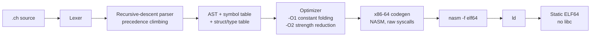

# Chronos

**An experimental systems programming language with its own compiler, written from scratch in C and x86-64 Assembly.**

Chronos aims at a *deterministic, memory-safe* language that's easy to learn. Today it is a working
compiler for a small, C-family language that emits **native Linux x86-64 ELF executables with no libc
and no runtime**. Output is NASM assembly plus raw syscalls. A second compiler, written entirely in
x86-64 assembly, handles a minimal declarative syntax as a first step toward self-hosting.

> **Status: experimental (v0.17).** The core language below works and is tested. Memory safety and
> determinism guarantees are **design goals, not implemented yet** (see [Roadmap](#roadmap)).
> The long-term language vision is in [docs/VISION.md](docs/VISION.md).

## What works today

**Main compiler: `compiler/bootstrap-c/chronos_v10.c`** (about 3,000 lines of C, single file)

- Functions with typed parameters and return values, recursion, `fn main() -> i32` as the entry point and process exit code
- `let` / `let mut` variables, globals, integer types `i8 i16 i32 i64 u8 u32 u64`
- Arithmetic, comparison and logical operators (`&&`, `||` with short-circuit), compound assignment, `++`
- `if`/`else`, `while`, `for`
- Fixed-size typed arrays (`let arr: [i32; 10];`), pointers (`*i32`, address-of, dereference), string indexing
- `struct` definitions, field access, `ptr->field`, arrays of structs, structs returned from functions
- Built-ins: `print`, `println`, `print_int`, `strlen`, `strcmp`, `strcpy`, `malloc`/`free`, file I/O (`open`, `read`, `write`, `close`), `exit`
- Optimization levels: `-O0` none, `-O1` constant folding, `-O2` constant folding plus strength reduction
- Code generation straight to NASM, linked with `ld` into a static ELF64 binary (no C runtime)

**Assembly compiler: `compiler/asm/`** (about 3,400 lines of hand-written x86-64 GAS assembly)

- Compiles the declarative `Program … Variables: … Print …` syntax to assembly
- Lexer, parser, symbol table, a precedence-climbing expression parser (`(a + b) * c`), and int-to-string conversion, all written without any library
- Produces working executables for hello world, typed variables and arithmetic expressions

### Verified (Oct 2026, Ubuntu x86-64, gcc + nasm + binutils)

| Check | Result |
|---|---|
| Test programs in `tests/` compiled with `-O2` | **124 of 124 compile** to native executables |
| Of those, programs that run to completion | 119 (4 crash, 1 times out; these are open bugs) |
| `examples/` (fibonacci, primes, fizzbuzz, gcd, binary search, bubble sort, file I/O, structs, typed arrays, benchmarks) | 18 of 19 build and run with `-O2`; `structs_complete.ch` builds only at `-O0` |
| Assembly compiler: `hello`, `test_variables`, `test_precedence`, `test_ultimate` | Correct output |

The legacy `run_tests*.sh` scripts target an earlier self-hosting experiment that now lives in `archive/`, and they are out of date.

## Quickstart

Requirements: Linux x86-64, `gcc`, `nasm`, `binutils` (`as`, `ld`).

```bash
sudo apt-get install -y gcc nasm binutils

# Build the C compiler
gcc -O2 -o compiler/bootstrap-c/chronos_v10 compiler/bootstrap-c/chronos_v10.c

# Hello world
cat > hello.ch <<'CH'
fn main() -> i32 {
    println("Hello, Chronos!");
    let x = 6 * 7;
    print_int(x);
    println("");
    return 0;
}
CH
./compiler/bootstrap-c/chronos_v10 -O2 hello.ch   # writes output.asm and links ./chronos_program
./chronos_program
# Hello, Chronos!
# 42
```

More examples:

```bash
./compiler/bootstrap-c/chronos_v10 -O2 examples/fibonacci.ch && ./chronos_program
./compiler/bootstrap-c/chronos_v10 -O2 examples/binary_search.ch && ./chronos_program
```

The pure-assembly compiler:

```bash
cd compiler/asm
./build.sh                          # as + ld, no C involved
./chronos test_ultimate.chronos     # writes output.s
as -o out.o output.s && ld -o program out.o && ./program
# Ultimate: (2 + 3) * 4 = 20
```

## Language sample

```chronos
struct Point {
    x: i32,
    y: i32
}

fn gcd(a: i32, b: i32) -> i32 {
    while (b != 0) {
        let t = b;
        b = a % b;
        a = t;
    }
    return a;
}

fn main() -> i32 {
    let arr: [i32; 10];
    let i = 0;
    while (i < 10) {
        arr[i] = i * 2;
        i++;
    }
    print("gcd(48, 18) = ");
    print_int(gcd(48, 18));
    println("");
    return 0;
}
```

## Architecture



## Design decisions

- **No runtime, no libc.** I/O, memory and exit go straight through Linux syscalls, so the generated binaries are tiny and their behavior is fully visible in the emitted assembly.
- **Readable assembly output.** The compiler writes NASM text instead of machine code, so every optimization can be inspected and diffed.
- **Bootstrapping path.** A small C compiler gives fast iteration, and a parallel compiler in pure assembly proves out the minimal toolchain that a self-hosted Chronos will need.

## Roadmap

- Memory safety: bounds-checked arrays, null-free references (`Option<T>`), an ownership model
- Determinism: defined overflow semantics, no undefined behavior
- Fix the known crashes listed above, then add a CI test harness over `tests/` and `examples/`
- Self-hosting, and macOS/ARM64 back ends (early scripts live in `compiler/macos*`)

Design notes and history: [docs/VISION.md](docs/VISION.md), [ROADMAP.md](ROADMAP.md), [CHANGELOG.md](CHANGELOG.md), [compiler/asm/README.md](compiler/asm/README.md).

## License

See [LICENSE](LICENSE).
